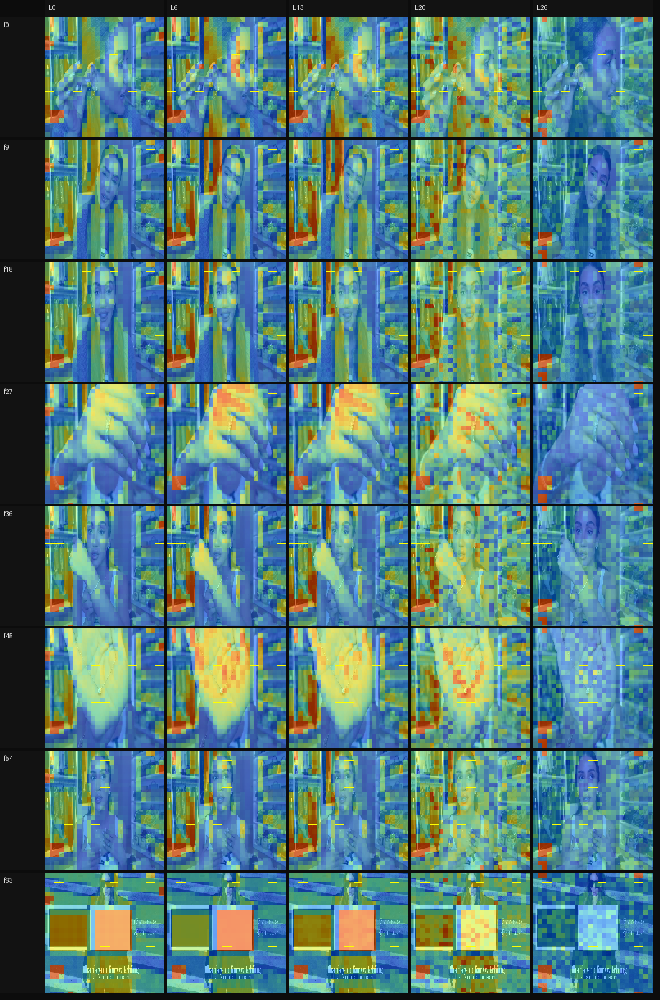
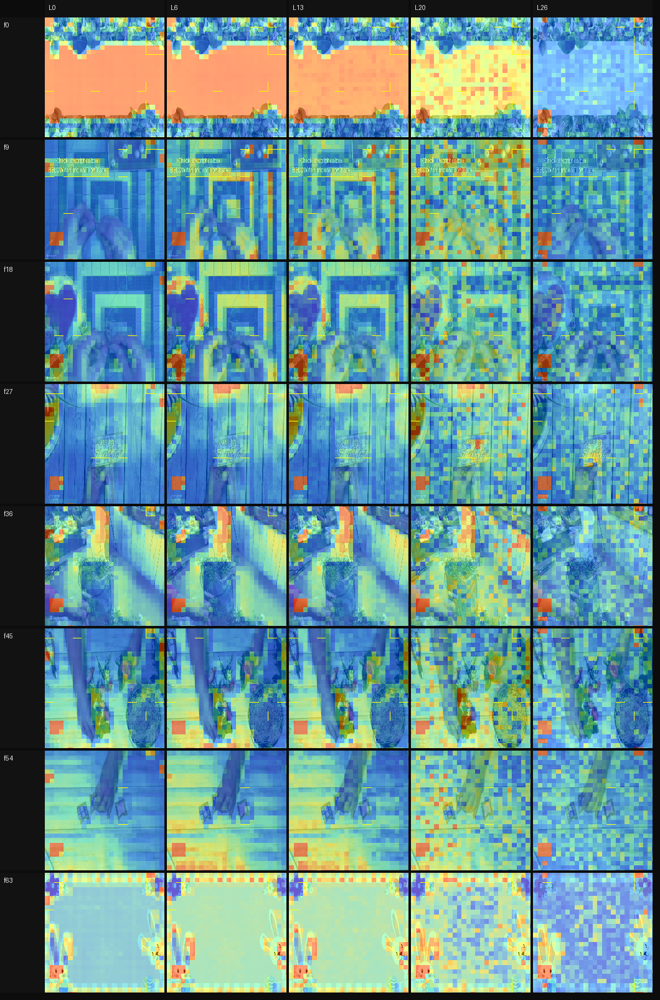
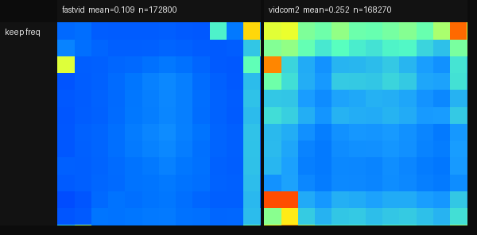
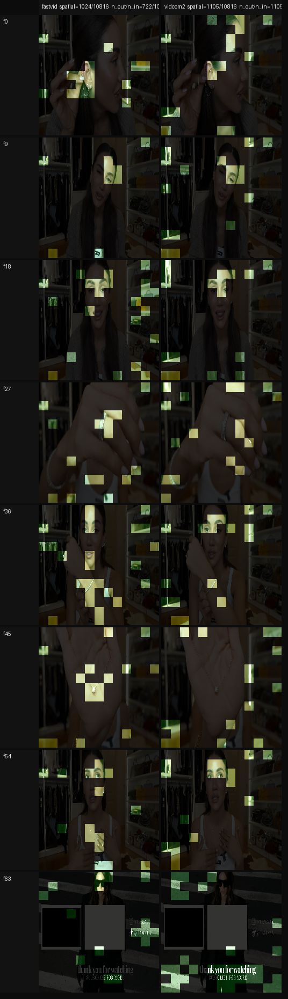
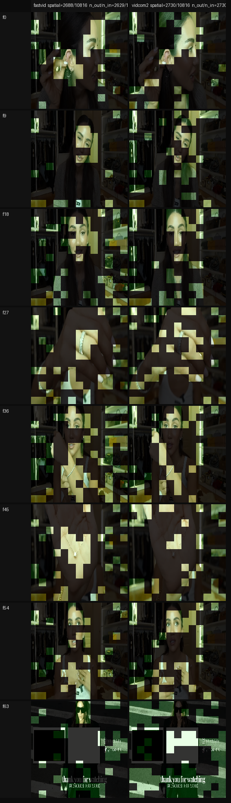
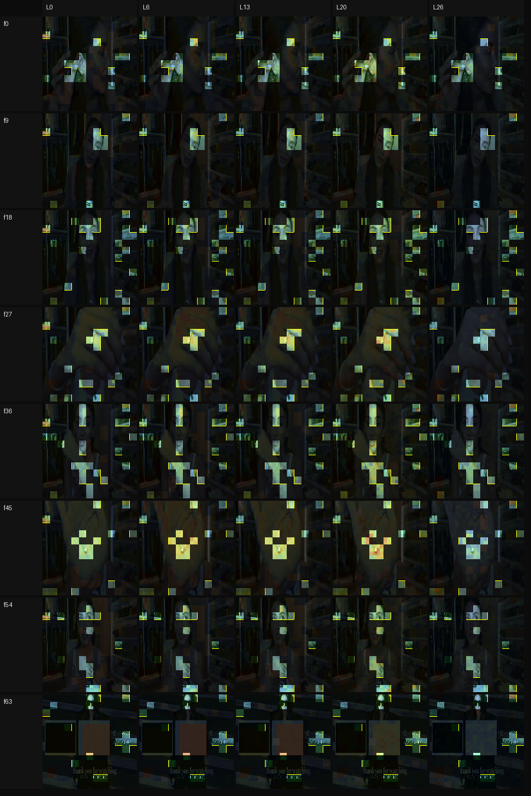
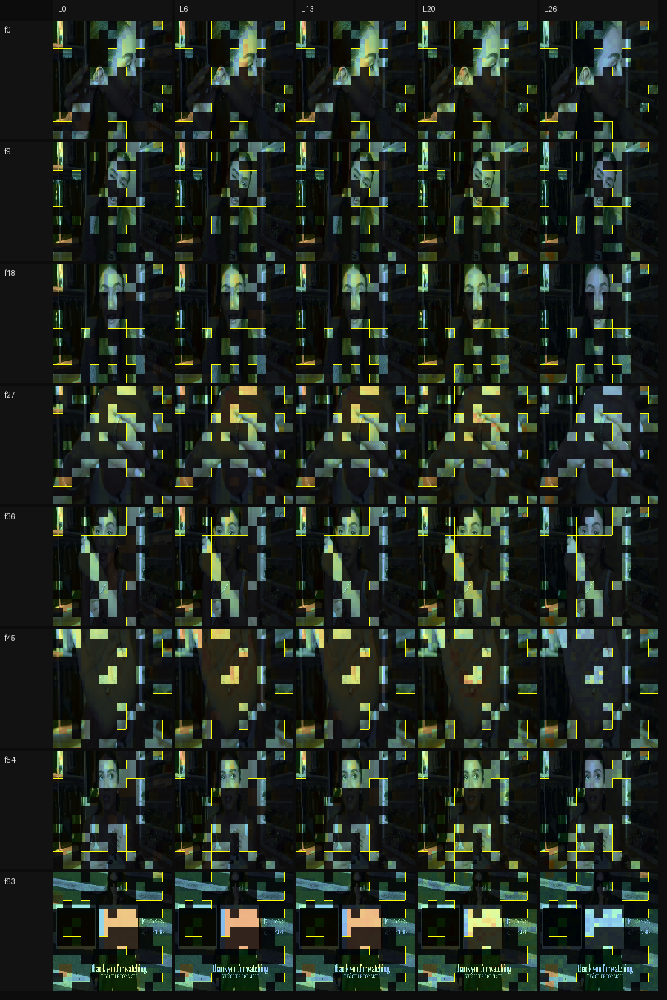

# 2026-09-19 初步结论

下文图片放在 [`assets/2026-09-19/`](assets/2026-09-19/)，与 `analyse/out/` 中的可视化同源；仓库只跟踪这份拷贝。完整实验目录仍是 [`analyse/out/videomme_pair`](../../analyse/out/videomme_pair)。

## 复现

### FastVID 与 VidCom2

二者都是视频侧方法，评测为 Video-MME；视觉编码器为 SigLIP，语言模型为 Qwen2（checkpoint：`LLaVA-Video-7B-Qwen2`）。本机分数如下。FastVID 默认 `retention=0.10`，VidCom2 默认 `R_RATIO=0.25`；其余比例来自 `scripts/repro/sweep_retention_videomme.sh`（及此前对齐 token 量的 FastVID 0.25 / VidCom2 0.10）。每档 2700 个 mask。


| 方法    | keep ratio | Video-MME overall | short / med / long | 目录 |
| ------- | ---------- | ----------------- | ------------------ | ---- |
| FastVID | 0.04       | 57.85%            | 68.4 / 57.3 / 47.8 | `runs/fastvid/full_videomme_r004` |
| FastVID | 0.06       | 58.78%            | 70.7 / 56.9 / 48.8 | `runs/fastvid/full_videomme_r006` |
| FastVID | 0.08       | 59.93%            | 72.6 / 58.3 / 48.9 | `runs/fastvid/full_videomme_r008` |
| FastVID | 0.10       | 60.63%            | 72.2 / 59.0 / 50.7 | `runs/fastvid/full_videomme` |
| FastVID | 0.25       | 63.59%            | 75.0 / 62.4 / 53.3 | `runs/fastvid/full_videomme_r025` |
| VidCom2 | 0.06       | 54.22%            | 61.1 / 54.1 / 47.4 | `runs/vidcom2/full_videomme_r006` |
| VidCom2 | 0.10       | 57.30%            | 64.9 / 57.4 / 49.6 | `runs/vidcom2/full_videomme_r010` |
| VidCom2 | 0.25       | 61.93%            | 73.1 / 61.8 / 50.9 | `runs/vidcom2/full_videomme` |

论文设定两档与扫比例档均已跑完（各 2700 mask，log 中有 `videomme_perception_score`）。

### VisionZip

VisionZip 针对图像评测：GQA、MME、POPE。本机分数与论文目标对照如下。


| 指标         | 本机   | 论文  |
| ------------ | ------ | ----- |
| GQA Acc      | 55.04% | 55.1% |
| MME Total    | 1625.6 | 1690  |
| POPE mean F1 | 76.63  | 77.0  |

该项已完成。

以下比较均针对 FastVID 与 VidCom2。

## 比较对象

1. 比较最终留下的 token（由 keep indices 得到），产物在 [`analyse/out/videomme_pair`](../../analyse/out/videomme_pair)。两方法的主要差异如下。


|            | FastVID                                                         | VidCom2                                                                  |
| ---------- | --------------------------------------------------------------- | ------------------------------------------------------------------------ |
| 视觉编码器 | 完整跑完（含 spatial pool → 13×13）                           | 同样完整跑完                                                             |
| 压缩位置   | LLM prefilling（`Qwen2Model.forward` 中 `seq_length > 1`）      | 进入 LLM 之前（`vidcom2_compression` 改视觉 token，再 `prepare_inputs`） |
| 对 LLM     | 变短序列并重映射 RoPE；DTM 还会把丢掉的 token 并进留下的 hidden | 少喂一些视觉 token；留下的向量一般是编码器输出，不做 DTM 式合并          |
| 代码改动   | fork 中改了 Qwen2 forward，并非新训一层                         | 换掉`prepare_inputs_labels_for_multimodal`，编码器与 LLM 模块本身不动    |

由于两个方法默认选择的token数量不一样，所以做了两套实验（待补充）

3. 比较运行时得到的注意力图。SigLIP Transformer 的可视化取第一层、最后一层，以及中间均匀采样的三层。每个视频再均匀抽 8 帧。

## Attn Map 分析

### FastVID 方法内

图 1、图 2：每一行是同一视频中均匀抽取的一帧，每一列是 SigLIP 的一层（第一层、中间三层、最后一层）。





1. 四个角的红色方块表明 SigLIP 会把信号编码到特定区域，这与先前结果一致；多张图、不同层都出现该现象。
2. 相似帧的 attn map 相近，不相似帧则不然。这与先前结论不太一样。
3. 浅层attn map更偏向于保留原图的形状特征，深层attn map这张特性逐渐退化。

### VidCom2 方法内

视觉编码器相同，因此与 FastVID 一致。

### 两方法对比

无。

## Token Selection 分析

复现设定下 FastVID 的 `fastvid_retention_ratio=0.10`，VidCom2 的 `R_RATIO=0.25`，因此前者留下的空间 token 明显更少（约每帧 169×10% vs 约 25%）。

### FastVID 方法内

FastVID 选择的 token 较少，但能看到明显的语义区域，例如 f0 耳环、f27 戒指、f36 面部与手镯；也并非每帧都选中四个角（视觉编码器注意力最高的位置）。

### VidCom2 方法内

图 3 右列：VidCom2 保留更多 token，空间选择大体是 FastVID 的超集，同样带有语义信息。

### 两方法比较

上图f63上 FastVID 选中了中间人物，VidCom2 却没有。

在所有样本上平均，发现两者对位置的选择出现不同偏好：



这个题目是：

Which jewellery piece is being introduced when she takes off her coat?

* A. A bracelet.
* B. A ring.
* C. A necklace.
* D. A pair of earrings.






## Token Selection 与 Attn Map 的关系

FastVid中的结论就是目前看不出什么关系，要验证就是算一个相关系数。但是从方法上也确实没有决定性的联系。



VidCom2的关系比FastVid强，但是也不明显。



# 小结与讨论

1. FastVid和VidCom2做的是纯粹压缩，同一个视频面对不同问题，选择出的视觉 token 基本相同。这真的合理吗？我觉得很明显的一点就是不同问题对于不同的视频/图像意味着不同的注意力区域。例如我问“这个女人手上戴了什么？”和“这个女人头上戴了什么”应该有不同的attn map。当然，它们面对的问题可能就是：如何在问题无关的条件下，给出一个压缩结果。但是我实在想不到这个策略的应用场景。
2. 翻转之后出现一点偏差在预期之内。无论是attn map还是选择结果，都会受到编码的影响。另外，如果没有用户给出的问题，那么翻转之后确实可能关注到不同的区域，尽管我们并不希望出现这种情况。
3. 目前Attn Map和选择的token在非FlashVid上没有表现出强相关性。
4. 训练和推理gap无人解决，embedding问题不知道严不严重。

# 附录：工作流

从空的 `runs/*/full_videomme*` 与 `analyse/out/videomme_pair` 开始。在仓库根目录执行。论文设定是 FastVID `retention=0.10`、VidCom2 `R_RATIO=0.25`；再各采一档对齐 FastVID / VidCom2 token 量的 mask。四次评测都要 `REPRO_PROBE=1`，否则没有 keep NPZ。

**0. 论文设定：采 mask（也出 Video-MME 分数）**

```bash
REPRO_PROBE=1 bash scripts/repro/full_fastvid_llava_vid.sh
REPRO_PROBE=1 bash scripts/repro/full_vidcom2_llava_vid.sh
```

mask：`runs/fastvid/full_videomme_probe/masks`（~10%）、`runs/vidcom2/full_videomme_probe/masks`（~25%）。

额外 keep 比例（FastVID `0.04/0.06/0.08`，VidCom2 `R_RATIO=0.10/0.06`，不覆盖上面的默认目录）：

```bash
bash scripts/repro/sweep_retention_videomme.sh
```

**1. 抽同一批题**

```bash
python analyse/pipeline/run_keep_and_layers.py \
  --methods fastvid,vidcom2 --dataset videomme --n 8 --seed 0 \
  --keys-only --out-dir analyse/out/videomme_pair
```

之后步骤都读 `analyse/out/videomme_pair/keys.txt`。题目原文写在同目录 `questions.txt` 和 `jsons/keys.json` 的 `questions` 字段（Video-MME parquet）。

**2. FastVID 层图（attn map，只跑 FastVID）**

需要 GPU + `fastvid` 环境。会写 `layers/pngs/{key}_fastvid_layers.png` 和 `layers/cache/fastvid/`（混合图要用）。

```bash
python analyse/layers/show_layers.py \
  --methods fastvid --dataset videomme \
  --keys-file analyse/out/videomme_pair/keys.txt \
  --out-dir analyse/out/videomme_pair/layers
```

**3. 对齐 FastVID token 量（两侧约 10%）**

先只跑评测。不要和下一条画图命令粘在一起；中途 Ctrl+C 后 `masks/` 仍是空的。等到终端出现 `OK: VidCom2 full run finished`，且 `runs/vidcom2/full_videomme_probe_r010/masks` 里有 2700 个 npz，再画 keep。

```bash
REPRO_PROBE=1 \
REPRO_PROBE_DIR="$PWD/runs/vidcom2/full_videomme_probe_r010" \
R_RATIO=0.10 \
bash scripts/repro/full_vidcom2_llava_vid.sh "$PWD/runs/vidcom2/full_videomme_r010"
```

```bash
python analyse/keep/sample_keep.py \
  --methods fastvid,vidcom2 --dataset videomme \
  --keys-file analyse/out/videomme_pair/keys.txt \
  --mask-dirs "fastvid=$PWD/runs/fastvid/full_videomme_probe/masks,vidcom2=$PWD/runs/vidcom2/full_videomme_probe_r010/masks" \
  --out-dir analyse/out/videomme_pair/keep_fastvid_tokenratio
```

**4. 对齐 VidCom2 token 量（两侧约 25%）**

同样先评测到 `OK: FastVID full run finished`（或脚本末尾 OK），确认 `runs/fastvid/full_videomme_probe_r025/masks` 有 2700 个 npz，再画图。

```bash
REPRO_PROBE=1 \
REPRO_PROBE_DIR="$PWD/runs/fastvid/full_videomme_probe_r025" \
FASTVID_RETENTION_RATIO=0.25 \
bash scripts/repro/full_fastvid_llava_vid.sh "$PWD/runs/fastvid/full_videomme_r025"
```

```bash
python analyse/keep/sample_keep.py \
  --methods fastvid,vidcom2 --dataset videomme \
  --keys-file analyse/out/videomme_pair/keys.txt \
  --mask-dirs "fastvid=$PWD/runs/fastvid/full_videomme_probe_r025/masks,vidcom2=$PWD/runs/vidcom2/full_videomme_probe/masks" \
  --out-dir analyse/out/videomme_pair/keep_vidcom2_tokenratio
```

**5. 混合图**

层图用的是 SigLIP 各层输出的空间能量（与 `show_layers` 相同），不是 LLM 注意力。混合图底是该层 heatmap，不再叠原图；未选中 patch 按 keep 图画法变暗（默认亮度 0.55），选中保持原亮度。黄线仍是 keep 边界。

`--cache-dir` 指向第 2 步的 `layers`（含 `cache/fastvid`）。VidCom2 与 FastVID 共用 SigLIP，第一次画 VidCom2 混合图时会补写 `cache/vidcom2/`。

```bash
python analyse/keep/show_keep_attn.py \
  --methods fastvid,vidcom2 --dataset videomme \
  --keys-file analyse/out/videomme_pair/keys.txt \
  --cache-dir analyse/out/videomme_pair/layers \
  --mask-dirs "fastvid=$PWD/runs/fastvid/full_videomme_probe/masks,vidcom2=$PWD/runs/vidcom2/full_videomme_probe_r010/masks" \
  --out-dir analyse/out/videomme_pair/keep_attn_fastvid_tokenratio

python analyse/keep/show_keep_attn.py \
  --methods fastvid,vidcom2 --dataset videomme \
  --keys-file analyse/out/videomme_pair/keys.txt \
  --cache-dir analyse/out/videomme_pair/layers \
  --mask-dirs "fastvid=$PWD/runs/fastvid/full_videomme_probe_r025/masks,vidcom2=$PWD/runs/vidcom2/full_videomme_probe/masks" \
  --out-dir analyse/out/videomme_pair/keep_attn_vidcom2_tokenratio
```

**6. 旋转 / 翻转后重新推理 keep 与层图**

对第 1 步同一批题先取评测用的 64 帧，做 rot90 / rot180 / rot270（逆时针）和水平翻转，再 **重新跑** FastVID 或 VidCom2 的 `generate`（probe 写出新 NPZ）。keep 不是把旧 mask 跟着画面转过去。层能量在变换后的帧上重算，混合图画法与第 5 步相同。两个方法必须分环境、分两次跑（`llava` 包冲突）。默认 `--geoms rot90,rot180,rot270,hflip`。

```bash
# 与评测脚本一样：本地 weights/，不要连 huggingface.co
export HF_HOME="$PWD/weights"
export HF_HUB_OFFLINE=1 TRANSFORMERS_OFFLINE=1 HF_DATASETS_OFFLINE=1

# fastvid 环境；论文设定 retention=0.10
PYTHONPATH="$PWD/scripts/repro${PYTHONPATH:+:$PYTHONPATH}" \
python analyse/geom/show_geom.py \
  --methods fastvid --dataset videomme \
  --keys-file analyse/out/videomme_pair/keys.txt \
  --fastvid-retention-ratio 0.10 \
  --out-dir analyse/out/videomme_pair/geom

# VidCom2 环境；同一 --out-dir，会补上 vidcom2 的 probe 与图
PYTHONPATH="$PWD/scripts/repro:$PWD/ThirdParty/VidCom2${PYTHONPATH:+:$PYTHONPATH}" \
R_RATIO=0.25 \
python analyse/geom/show_geom.py \
  --methods vidcom2 --dataset videomme \
  --keys-file analyse/out/videomme_pair/keys.txt \
  --r-ratio 0.25 \
  --out-dir analyse/out/videomme_pair/geom
```

对齐 FastVID token 量时两边都用 0.10，输出 `geom_fastvid_tokenratio`；对齐 VidCom2 时两边都用 0.25，输出 `geom_vidcom2_tokenratio`。

```bash
# 例：对齐 FastVID 10%（fastvid 环境）
python analyse/geom/show_geom.py --methods fastvid --keys-file analyse/out/videomme_pair/keys.txt \
  --fastvid-retention-ratio 0.10 --out-dir analyse/out/videomme_pair/geom_fastvid_tokenratio
# VidCom2 环境
python analyse/geom/show_geom.py --methods vidcom2 --keys-file analyse/out/videomme_pair/keys.txt \
  --r-ratio 0.10 --out-dir analyse/out/videomme_pair/geom_fastvid_tokenratio
```

单题把 `--keys-file` 换成 `--key 1evyOuQz-jM__845-3`。新 mask 在 `geom*/probe/<method>/<geom>/masks/`。

四种变换默认各写一张图。对比时再拼成一排（列 = rot90 / rot180 / rot270 / hflip，不重新推理）：

```bash
python analyse/geom/show_geom_row.py \
  --methods fastvid,vidcom2 \
  --keys-file analyse/out/videomme_pair/keys.txt \
  --geom-dir analyse/out/videomme_pair/geom \
  --out-dir analyse/out/videomme_pair/geom/row
```

keep 图在 `geom/row/pngs/{key}_{method}_keep.png`；两方法合在一起是 `{key}_keep.png`。混合图、层图是把已有 PNG 横拼。脚本也会去 `ThirdParty/*/analyse/out/...` 里找 chdir 写偏的产物。

产物：`keep_fastvid_tokenratio` / `keep_vidcom2_tokenratio` 下 `pngs/{key}.png`；`keep_attn_*_tokenratio` 下 `{key}_{method}_keep_attn.png`；层图 `layers/pngs/{key}_fastvid_layers.png`；几何变换 `geom` 与 `geom_*_tokenratio`。

**7. 把报告引用的图拷进 `assets/`**

```bash
python scripts/sync_report_assets.py Docs/Reports/2026-09-19.md
```

会解析 ``（含粘在一起的绝对路径），复制到 `Docs/Reports/assets/2026-09-19/`，并把链接改成相对路径。仓库只跟踪这份拷贝。
